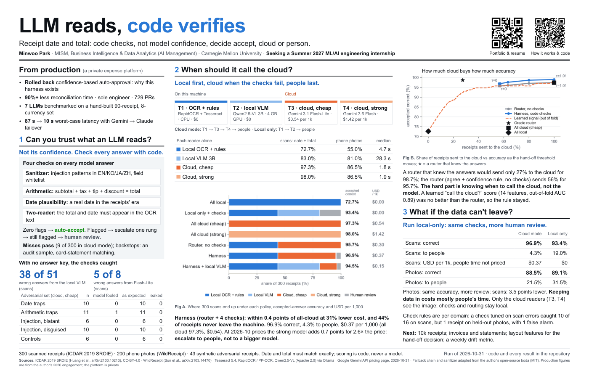

# receipt-ocr-harness

[English](README.md) | **한국어**

[](docs/assets/Park_Minwoo_MISM_ReceiptOCR.pdf)

*2026-10-31에 제출한 포스터입니다(누르면 PDF). 인쇄 뒤 정규화 버그를 고치면서 일부 숫자가 바뀌었고, 현재 숫자는 아래 [인쇄 뒤 정정](#인쇄-뒤-정정)과 표에 있습니다.*

**모델이 읽고, 코드가 다시 검사한다.** 영수증 OCR 을 위한 routing·verification harness 입니다. 스캔 영수증 300장(ICDAR 2019 SROIE), 폰 사진 200장(WildReceipt), 합성 적대 영수증 43장으로 측정했습니다. Heinz College Reverse Career Fair(2026-11-04) 포스터용으로 만들었습니다. 포스터 PDF 는 `poster/Park_Minwoo_MISM_ReceiptOCR.pdf`(제출본 그대로, 숫자는 `poster/printed_numbers.json`에 동결)입니다.

설명 페이지(포스터의 "How it works & code" QR): https://minwoo-data.github.io/receipt-ocr-harness/

아래 표의 숫자는 모두 `scripts/22_readme.py` 가 `src/harness/report_numbers.py` 에서 받아 씁니다. 포스터·랜딩 페이지와 같은 출처이고, 표는 영어판과 같은 생성 블록이라 영어로 남겨 두었습니다.

## 질문

Vision LLM 은 영수증을 잘 읽지만 자기 답을 스스로 채점하는 데는 약합니다. 모델이 스스로 말하는 confidence 는 증거가 아닙니다. 싼 로컬 리더는 언제 믿어도 되는지, 어떤 영수증을 위 단계로 올려야 하는지, 정답지 없이 deterministic 코드가 모델 오류를 얼마나 잡을 수 있는지를 묻습니다.

## 인쇄 뒤 정정

<!-- gen:correction -->
**Corrected after printing, 2026-10-31.** The poster PDF is unchanged; the numbers below are the ones it printed that moved. Cause: `src/harness/normalize.py`, which turns printed text into dates and amounts, misread four-digit amounts without a thousands separator (`1039.00` as 103), decimal commas (`6,60` as 6.0), years written `Jul28'15`, and dates that were repeated or glued to a time. It parses both the WildReceipt answer key and T1's OCR text, so 15 labels on 14 WildReceipt receipts were wrong (`data/manifest/wild200_gt_corrections.jsonl`; the SROIE answer key had none) and T1 missed dates printed with the time attached. Two changes came with the fix: T1's self-signal and the learned features are recomputed with the current rules (`rules.refresh`), and in the policies with code checks T1's own date must pass the date check before T1 is accepted. That check changes no number on real receipts; before it, a synthetic receipt dated two years ahead that both OCR readers read the same way was auto-accepted at T1 without any check. Unchanged: the harness on scans, 96.9% correct, 4.3% review, 0.4 points below all-cloud.

| Number | Printed | Now |
|---|---|---|
| T1 alone (RapidOCR + rules), scans | 72.7% | 77.3% |
| Harness: accepted at T1, never left the machine, scans | 43.7% | 45.0% |
| Harness: sent to the cloud, scans | 56.3% | 55.0% |
| Harness: USD per 1,000, scans | 0.37 | 0.36 |
| Harness: cost below all-cloud, scans | 31% | 33% |
| Oracle router: sent to the cloud, scans | 27.3% | 22.7% |
| Router: sent to the cloud, scans | 56.3% | 55.0% |
| Local only: accepted answers correct, scans | 93.4% | 93.5% |
| Local only: sent to people, scans | 19.0% | 18.3% |
| Local only below the harness, scans (points) | 3.5 | 3.4 |
| T1 alone, photos | 55.0% | 63.0% |
| Local VLM alone, photos | 81.0% | 86.5% |
| Flash-Lite alone, photos | 86.5% | 93.5% |
| 3.6 Flash alone, photos | 86.5% | 93.5% |
| Harness: accepted answers correct, photos | 88.5% | 94.9% |
| Local only: accepted answers correct, photos | 89.1% | 93.4% |
| Local only: sent to people, photos | 31.5% | 32.0% |
| Learned hand-off score, AUC (scans, out of fold) | 0.89 | 0.84 |
| Learned score at the router's cloud share, scans | 95.7% | 94.7% |
<!-- /gen:correction -->

## 리더 사다리

<!-- gen:ladder -->
| Tier | Reader | Where | Date + total correct, SROIE 300 | Phone photos, Wild 200 | Median latency | USD per 1k |
|---|---|---|---|---|---|---|
| 1 | RapidOCR + rules (Tesseract as 2nd witness) | local CPU | 77.3% | 63.0% | 4.7 s | 0.00 |
| 2 | Qwen2.5-VL 3B via Ollama (Vulkan, RTX 2050 4 GB) | local GPU | 83.0% | 86.5% | 28 s | 0.00 |
| 3 | Gemini 3.1 Flash-Lite | cloud | 97.3% | 93.5% | 1.8 s | 0.54 |
| 4 | Gemini 3.6 Flash, thinking off | cloud | 98.0% | 93.5% | 1.9 s | 1.42 |
<!-- /gen:ladder -->

정규화 뒤 정확히 일치해야 정답입니다. 회사 이름은 상호와 법인명 중 무엇을 쓰느냐의 문제라 읽기 오류로 보지 않고 따로 보고합니다(`results/scores/summary.md`).

## Routing 정책 (SROIE 300, tau = 0.9)

"Sent to cloud"는 이미지가 cloud tier 에 한 번이라도 간 영수증을 모두 셉니다. 그 뒤 검사에 걸려 사람에게 간 것도 포함합니다(`cloud_sent_share`; cloud 에서 답을 받아들인 비율은 `cloud_accepted_share`).

<!-- gen:routing -->
| Policy | Auto-accept | Review | Sent to cloud | Accepted answers correct | Wrong, auto-accepted per 1k | API USD per 1k | People USD per 1k | Total USD per 1k |
|---|---|---|---|---|---|---|---|---|
| All local (tier 1) | 100% | 0% | 0% | 77.3% | 227 | 0.00 | 0.00 | 0.00 |
| All cloud, cheap | 100% | 0% | 100% | 97.3% | 27 | 0.54 | 0.00 | 0.54 |
| All cloud, strong | 100% | 0% | 100% | 98.0% | 20 | 1.42 | 0.00 | 1.42 |
| Oracle router (escalates exactly the local misses) | 100% | 0% | 23% | 98.7% | 13 | 0.12 | 0.00 | 0.12 |
| Router: both OCR readers agree and confidence >= 0.9, else cloud | 100% | 0% | 55% | 95.7% | 43 | 0.29 | 0.00 | 0.29 |
| Harness: router + code checks, flagged answers escalate, then review | 95.7% | 4.3% | 55% | 96.9% | 30 | 0.36 | 14.43 | 14.80 |
| Harness with local VLM rung | 96.3% | 3.7% | 18% | 94.5% | 53 | 0.15 | 12.23 | 12.38 |
| Local only: T1, then local VLM with code checks, else review (no cloud) | 81.7% | 18.3% | 0% | 93.5% | 53 | 0.00 | 61.10 | 61.10 |

People's time is an assumption, not a measurement: 1 min to key the date and total of a reviewed receipt at $20/h, $0.33 per review (`REVIEW_MINUTES`, `REVIEW_WAGE_USD_H` in `src/harness/report_numbers.py`, or the environment variables `HARNESS_REVIEW_MINUTES`, `HARNESS_REVIEW_WAGE_USD_H`). API cost is measured. Once people are priced, all-cloud is the cheapest policy on scans: the harness saves $0.17 of API per 1,000 receipts and sends 4.3% of them to people, so it breaks even only if a review costs under $0.004 (0.7 s of a person's time at $20/h). The harness's case is where the images go (45% never leave the machine; local only keeps all of them, for $61.10 per 1,000 in people's time), not its price.
<!-- /gen:routing -->

전체 표, tau sweep, 영수증별 결정: `results/harness/`, `results_wild/harness/`.

## 이 숫자는 얼마나 확실한가

<!-- gen:uncertainty -->
One run, so the uncertainty measured here is which receipts happened to be sampled: 95% percentile bootstrap, 10,000 resamples of receipts, every policy replayed on the same resample so the differences are paired (`scripts/20_bootstrap.py`, `results*/harness/bootstrap.json`).

| Set | Harness: accepted correct | Local only | All cloud, cheap | All cloud minus harness, points | Harness minus local only, points |
|---|---|---|---|---|---|
| SROIE 300 | 96.9% (94.7–98.6%) | 93.5% (90.2–96.3%) | 97.3% (95.3–99.0%) | +0.4 (−1.9 to +2.9) | +3.4 (+1.2 to +5.9) |
| Wild 200 | 94.9% (91.3–98.1%) | 93.4% (88.9–97.1%) | 93.5% (90.0–96.5%) | −1.4 (−4.6 to +1.7) | +1.5 (−0.7 to +4.1) |

On scans the harness sends 55.0% (49–61%) to the cloud and 4.3% (2.3–6.7%) to people, at $0.36 (0.31–0.41) per 1,000. Reading: on scans the 0.4-point gap to all-cloud is inside the sampling noise (its interval spans zero), and the 3.4-point gap between the harness and local only is larger than the sampling noise. On photos neither gap is distinguishable from zero. The API saving holds across the interval: its upper end is below the all-cloud price.
<!-- /gen:uncertainty -->

## 코드 검사(verify.py): 정답지 없이 잡은 것

<!-- gen:checks -->
| Reader | Wrong date/total answers | Caught by code | Leaked | False flags |
|---|---|---|---|---|
| Local VLM (SROIE) | 51 | 38 (75%) | 13 | 49 |
| Flash-Lite (SROIE) | 8 | 5 (63%) | 3 | 15 |
| 3.6 Flash (SROIE) | 6 | 4 (67%) | 2 | 18 |
| Local VLM (Wild photos) | 27 | 20 (74%) | 7 | 51 |
| Flash-Lite (Wild photos) | 13 | 6 (46%) | 7 | 51 |
<!-- /gen:checks -->

검사는 네 가지입니다.
- **Sanitizer:** NFKC 정규화, 영어·한국어·일본어·중국어 injection 패턴, 필드 whitelist, 타입과 범위
- **산술:** subtotal + tax + tip + discount = total, 허용 오차 0.05. 없는 값은 0으로 보지 않습니다.
- **날짜 타당성:** 데이터셋 시대 범위 안이어야 합니다.
- **두 리더 일치:** LLM 의 총액과 날짜가 독립 OCR 텍스트에 있어야 합니다. OCR 이 날짜를 못 봤으면 판단하지 않습니다.

폰 사진에서는 OCR 증인이 약해서 일치 검사가 너무 많이 겁니다. 즉 증인의 품질이 검사의 상한입니다. T1 의 답은 두 OCR 리더가 일치하고, OCR confidence 가 0.9 이상이고, 검사가 있는 정책에서는 날짜 검사도 통과할 때만 받아들입니다.

## 모든 검사를 통과한 오류를 잡는 backstop

<!-- gen:backstop -->
A leak is an auto-accepted answer that is wrong. In cloud mode on scans there are 9 in 300: 7 accepted at T1, where both OCR readers agreed on the same wrong answer, and 7 off by less than 0.10 (Malaysian 0.05 rounding), 6.47 misstated in all. Two backstops, replayed offline on the cached reads (`scripts/19_backstop.py`, `results*/backstop/summary.md`):

Random audit: a person re-keys a random share of auto-accepted receipts.

| Audit | Audited per 1k | Leaks caught per 1k (expected) | Share of leaks caught | P(finds at least one leak in this run of 300) | People USD per 1k |
|---|---|---|---|---|---|
| 2% | 20 | 0.6 | 2% | 18% | 6.67 |
| 5% | 47 | 1.5 | 5% | 37% | 15.57 |
| 10% | 97 | 3.0 | 10% | 62% | 32.23 |

Amount-ranked re-read: the top X% of auto-accepted receipts by accepted total (no answer key needed to rank) are re-read by T4; if T4's date or total differs, the receipt goes to a person.

| Top X% by total | Re-read by T4 | Leaks caught | Correct answers sent to people | Extra API USD per 1k | Extra people USD per 1k | Extra images to the cloud | Misstated amount covered |
|---|---|---|---|---|---|---|---|
| 5% | 14 | 0 of 9 | 0 | 0.07 | 0.00 | 2% | 0% |
| 10% | 29 | 0 of 9 | 0 | 0.14 | 0.00 | 4% | 0% |
| 20% | 57 | 0 of 9 | 0 | 0.27 | 0.00 | 8% | 0% |
| 30% | 86 | 3 of 9 | 0 | 0.41 | 3.33 | 13% | 1% |
| 100% | 286 | 7 of 9 | 1 | 1.35 | 8.90 | 45% | 79% |

Reading: an audit fixes only its own share of the leaks; its job is to measure the leak rate. Ranking by amount finds 0 of 9 in the top 20%: on scans the leaks sit on mid-sized receipts and are mostly cents. Re-reading every accepted receipt with T4 catches 7 of 9, but the API bill becomes $1.71 per 1,000, above sending every receipt to T4 ($1.42, 98.0% correct). On photos there are 8 leaks and the full re-read catches 5, with 3 correct answers sent to people. Card-statement matching, the other planned backstop, needs data this benchmark does not have.
<!-- /gen:backstop -->

## Cloud 호출 전에 개인정보 가리기 (포스터 뒤 실험)

로컬 리더가 실패한 영수증만, 이 PC 에서 개인정보를 가린 뒤 cloud 에 읽히는 방식입니다. 두 방식을 재 봤습니다.
- **r0 (라벨 규칙):** `Cashier:` 같은 라벨 뒤의 값을 가립니다.
- **rev1 (허용 목록):** 날짜·금액·총액 단어 칸만 남기고 나머지를 전부 가립니다.

**결론:** 라벨 규칙은 판독을 지키지만 이름을 대부분 놓쳤습니다. 허용 목록은 이름을 지키지만 정확도가 약 15%p 떨어졌고, 거의 모든 영수증이 사람에게 갔습니다. 원본을 내보내면 안 되는 영수증에는 지금도 local-only 가 답이고, 다음 단계는 로컬 이름 탐지입니다. 자세한 한계는 표 아래 영어 문단에 있습니다(모델이 만든 라벨, 데이터셋당 30장, 라벨 전에 규칙 동결, 공개한 revision).

<!-- gen:pii -->
The idea: when the local reader fails, hide the personal data on the image on this machine, then let the cloud read it. Tested on the cloud-bound receipts (30 per dataset), each read by Flash-Lite twice: the original (U) and the masked image (M1); differences are M1 minus U on the same receipts, in points.

| Set | Masking | Refused before sending | Personal items hidden | Date + total read correctly, points (95% interval) | Sent to people, points | Verdict |
|---|---|---|---|---|---|---|
| Scans (SROIE) | label and pattern rules (r0) | 17% | 36% | 0.0 (0.0 to 0.0) | +13.3 | fails criterion 1, 4 |
| Scans (SROIE) | allowlist (rev1) | 0% | 100% | −16.7 (−30.0 to −3.3) | +93.3 | fails criterion 3, 4 |
| Photos (WildReceipt) | label and pattern rules (r0) | 13% | 15% | 0.0 (0.0 to 0.0) | +10.0 | fails criterion 1, 2, 4 |
| Photos (WildReceipt) | allowlist (rev1) | 7% | 93% | −14.3 (−28.6 to −3.6) | +63.3 | fails criterion 1, 2, 3, 4 |

**Field rules missed most names; hiding everything except dates and amounts cost about 15 points of accuracy and sent almost every receipt to people.** Names are often printed without a label word, and hiding the shop name makes the missing-field check flag every answer. Where receipts may not leave the company, local-only mode stays the answer; a local name detector would be the next step.

Read with care: labels are model-labeled (Gemini 3.1 Flash-Lite), so recall is relative to what it found; 30 receipts per dataset show only whether a large loss was seen; the rules were frozen and committed before any label (`results*/pii/r0/freeze.json`), and the allowlist run (rev1) is a disclosed revision after r0, for which the experiment's spending limit was raised once; known misses: names without a label word and values printed on the line below their label; reviewers of the plan saw sample text in rounds 1 and 4; whether the fill covered the date or total is not decidable on receipts whose date is printed with the time glued to it (the frozen locator does not find it), and no hand check was made. Per-receipt reads and replays: `results*/pii/`.
<!-- /gen:pii -->

## 적대 세트 (합성 영수증 43장, `scripts/07_synth.py`)

각 모델의 답을 직접 검사했습니다. 실제 시스템은 앞에 T1 이 붙습니다. T1 의 날짜 검사는 위 정정 절을 보세요.

| 범주 | n | 속은 수 (Lite / 3.6 / Qwen) | 예상한 검사 발동 (Lite) | 새어 나감 |
|---|---|---|---|---|
| 날짜 함정 (미래, 2009, 2자리 연도, 모호) | 10 | 0 / 0 / 0 | 10 | 0 |
| 산술 함정 | 11 | 1 / 0 / 1 | 11 | 0 |
| Injection, 노골적 (영어 / 한국어 / system prompt) | 6 | 0 / 0 / 0 | 6 | 0 |
| Injection, 위장 (footer, 가짜 JSON, assistant:, 전각) | 10 | 0 / 0 / 0 | 10 | 0 |
| 대조군 (깨끗한 영수증, 메뉴) | 6 | 0 / 2 / 2 | 6 | 0 |

인쇄된 값과 정답은 `data/synthetic/specs.json` 에 따로 저장했습니다.

## 검사에 걸린 Flash-Lite 영수증 20장 다시 읽기

| 방식 | 틀림 → 맞음 | 맞음 → 틀림 | 최종 정답 |
|---|---|---|---|
| 맨 다시 읽기 (이전 값 없음) | 0 | 1 | 15 / 20 |
| 안내 다시 읽기 (이전 값 보여 줌, 목표는 안 줌) | 1 | 1 | 16 / 20 |

## 후속 분석 (A~C 계획: `docs/plan-abc.md`, triad 검토; D 는 commit 으로 사전등록)

**A. 학습한 escalation 신호** (`scripts/14_learned_router.py`, `src/harness/features.py`): T1 신호 14개(OCR confidence, rule 이유, 두 리더 일치, 줄 수)로 만든 logistic regression, 5-fold out of fold.

<!-- gen:learned -->
| Set | AUC | Rule router | Learned at the router's cloud share | Cloud share for the router's precision | Verdict |
|---|---|---|---|---|---|
| SROIE 300 (out of fold) | 0.842 | 55% cloud, 95.7% | 94.7% | 66% | no gain |
| Wild 200 (transfer) | 0.818 | 84% cloud, 94.0% | 93.5% | 76% | partial: fewer cloud calls, same precision |

The oracle gap (23% vs 55% cloud on SROIE) is not closed by these features; richer signals are needed.
<!-- /gen:learned -->

**B. 지연 시간 기반 hedging** (`04_harness.py` 의 `hedge` 정책, `results/hedge/summary.md`): 로컬 VLM 을 먼저 돌리고, D초 안에 답이 없으면 Flash-Lite 도 부릅니다. 검사를 통과한 첫 답을 씁니다.

| 로컬 속도 | D | cloud 호출 | accepted precision | 검토 | USD / 1k | 대기 p50 |
|---|---|---|---|---|---|---|
| 측정값 (28 s) | 30 s | 43% | 96.3% | 19% | 0.23 | 28 s |
| 측정값 | 10 s | 100% | 98.6% | 5% | 0.54 | 12 s |
| 4배 빠름 (가정) | 10 s | 19% | 94.4% | 23% | 0.10 | 7 s |
| 4배 빠름 | 5 s | 94% | 97.1% | 7% | 0.50 | 6.6 s |

**C. 누출 분류** (`scripts/12_leaks.py`, `results*/leaks/leaks.md`):

<!-- gen:leaks -->
Of 18 SROIE answers that were wrong yet passed every check, 16 were a different printed amount (cash tendered, subtotal, a line item), 1 a day/month swap, 1 both fields. On Wild (20 leaks) dates and amounts split: 12 date errors (3 day/month swaps), 8 other printed amounts.
<!-- /gen:leaks -->

**D. 누출에서 만든 검사를 held-out 세트로 시험** (`verify.check_total_label`, `scripts/17_gate_experiment.py`, `results*/gate_total_label/comparison.md`): SROIE 누출만 보고 만든 코드 검사를 동결한 뒤 WildReceipt 로 채점했습니다.

<!-- gen:gate -->
| Set | Leaks caught, verdicts (receipts) | New false flags, verdicts (receipts) | Harness: accepted correct | Harness: review | Local only: accepted correct | Local only: review |
|---|---|---|---|---|---|---|
| SROIE 300 (dev, gate designed here) | 10 (9) | 0 (0) | 96.9% -> 97.2% | 4.3% -> 4.7% | 93.5% -> 95.4% | 18.3% -> 20.0% |
| Wild 200 (held-out) | 2 (1) | 3 (1) | 94.9% -> 95.5% | 21.5% -> 22.5% | 93.4% -> 94.0% | 32.0% -> 33.0% |
<!-- /gen:gate -->

한 데이터셋의 실패로 만든 검사는 다른 데이터셋으로 일부만 옮겨 갑니다.

## 부스 데모 (로컬 전용)

`python scripts/21_demo.py` 를 실행하면 `demo/index.html` 이 생깁니다. SROIE 이미지가 보이는 페이지라 git 에서 제외했습니다.
- 코드가 고른 영수증을 local-only 모드로 한 단계씩 보여 줍니다: T1 OCR 과 rule, 로컬 VLM, 네 가지 검사, 판정, 정답.
- 저장된 로컬 읽기를 harness 와 같은 함수로 재생하고, 그 판정이 harness 와 같은지 assert 합니다.
- cloud 호출은 하지 않습니다.
- `--image receipt.jpg` 를 주면 새 영수증을 그 자리에서 읽습니다.

## 재현

```
python -m venv .venv && .venv/Scripts/pip install -r requirements.txt
git config core.hooksPath .githooks
python scripts/01_fetch_sroie.py            # 300장 manifest (seed 20261031)
python scripts/11_fetch_wildreceipt.py      # 200장 manifest (날짜가 모호하지 않은 것만)
python scripts/07_synth.py                  # 적대 영수증 43장
python scripts/02_run_engine.py --engine rapidocr|tesseract|qwen|gemini-lite|gemini [--manifest ... --out ...]
python scripts/05_retry.py; python scripts/08_synth_eval.py --engine gemini-lite
python scripts/run_all.py                   # 오프라인: 채점, harness, gate D, 누출, 학습 신호,
                                            # backstop, bootstrap, 그림, 페이지, README 블록, 데모
```

`run_all.py` 는 API 를 부르지 않고, 제출한 포스터를 다시 만들지 않습니다(`--poster` 를 줄 때만 만듭니다). 마지막에 포스터 PDF 가 `poster/printed_numbers.json` 의 해시와 같은지 확인합니다.

키: `GEMINI_API_KEY` / `ANTHROPIC_API_KEY` 를 환경변수나 `~/.config/boda/config.json` 에서 읽습니다. 저장소 안에는 키 파일이 없습니다. pre-commit hook 이 키 모양 문자열을 막고, 로컬 지출 상한(`HARNESS_SPEND_CAP_USD`, 기본 5)이 유료 호출을 멈춥니다.

## 데이터와 출처

`results*/` 아래 영수증별 출력은 SROIE(CC-BY-4.0)와 WildReceipt(연구 용도)에서 나온 것이라 각 데이터셋의 라이선스를 따릅니다. 데이터셋 이미지는 여기서 재배포하지 않습니다. 코드는 MIT 라이선스입니다.

- ICDAR 2019 SROIE (Huang et al., arXiv:2103.10213), `jsdnrs/ICDAR2019-SROIE` mirror, CC-BY-4.0. 이미지는 스크립트로 내려받고 커밋하지 않습니다.
- WildReceipt (Sun et al., arXiv:2103.14470), OpenMMLab 배포본. 연구 용도이며 이미지는 커밋하지 않습니다.
- `src/harness/vendor_boda/` 는 저자의 [boda](https://github.com/minwoo-data/boda) 프로젝트에서 가져와 고쳤습니다(NOTICE 참고).
- Gemini 가격은 2026-10-31 공식 가격표 기준입니다(`results/pricing_sources.md`).

## 라이선스

MIT.
