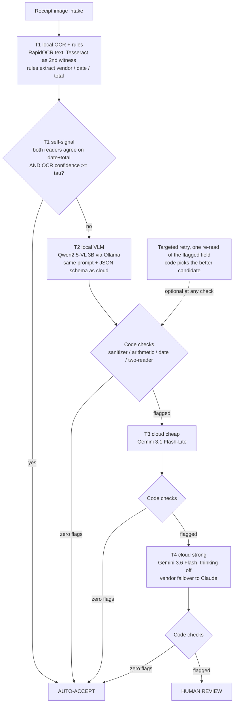

# receipt-ocr-harness 전체 줄거리 (한국어 요약)

기술 용어·모델명·기법은 영어 그대로 둡니다. 숫자는 2026-10-31 실행 기준이며 원본은 `results/`, `results_wild/`, `README.md` 에 있습니다.

## 한 문단 요약

영수증 이미지에서 **날짜와 총액**을 뽑는 일을, 싼 로컬 리더(RapidOCR + rules, Qwen2.5-VL 3B)부터 클라우드 vision LLM(Gemini 3.1 Flash-Lite, Gemini 3.6 Flash)까지 **사다리(ladder)** 로 배치하고, 모델이 낸 답을 모델의 self-reported confidence 가 아니라 **코드 검증(sanitizer, arithmetic identity, date plausibility, two-reader agreement)** 으로 판정해 **auto-accept / escalate / human review** 셋 중 하나로 보내는 하네스를 만들고 측정했습니다. 300장 스캔(SROIE)과 200장 사진(WildReceipt), 합성 적대 영수증 43장으로 평가했고, 결론은 세 가지입니다. 싼 리더도 73~83% 까지는 오지만 혼자 믿기엔 부족하다. 비용의 병목은 모델이 아니라 **escalation signal**(언제 올려 보낼지 아는 신호)이다. 코드 검증은 정답 없이도 로컬 모델 오류의 75%, 클라우드 오류의 63%를 잡는다.

## 영수증 한 장이 들어오면 (flow)

변형 두 가지도 같은 틀 안에서 시뮬레이션했습니다. **local_only**: 클라우드를 아예 빼고 T1 → T2 → review (스캔 93.4% 정확도, 검토 19%, 비용 0). **hedge**: T2 를 시작하고 D초 안에 답이 없으면 클라우드를 병렬로 호출, 먼저 검증을 통과한 답을 채택 (이 노트북 기준 D=30s 면 43%만 클라우드, 96.3%).

## 실험이 어떻게 돌아갔나

1. **데이터.** SROIE 300장(시드 고정, 말레이시아 스캔), WildReceipt 200장(사진, 날짜가 모호하지 않은 것만), 합성 43장(printed values 와 truth 를 분리 저장해 생성기 실수가 라벨을 오염시키지 못하게 함). 채점은 normalization 뒤 exact match, 전부 코드.
2. **리더 4종 실행.** 같은 prompt 와 JSON schema 를 로컬 VLM 과 클라우드에 동일 적용(공정 비교). 비용은 응답의 token usage × 공식 단가.
3. **검증 게이트.** 모델 출력은 untrusted input 으로 취급. NFKC normalization 후 EN/KO/JA/ZH injection pattern 검사, field whitelist 와 type/range, subtotal + tax + tip + discount = total(허용오차 0.05, 결측은 0이 아님, tax-inclusive 변형), 날짜 타당성(데이터셋 시대 기준), two-reader agreement(LLM 의 총액·날짜가 독립 OCR 텍스트에 있는가). 모델 confidence 는 기록만 한다.
4. **정책 재생(replay).** 저장된 결과로 모든 라우팅 정책을 오프라인 재생. all_local / all_cloud / oracle / rule router / harness / local_only / hedge. **oracle** 은 정답을 아는 가상의 라우터로, 로컬이 틀릴 것만 정확히 올려 보내는 상한선. 실제 라우터와의 차이가 **oracle gap**.
5. **학습된 신호(A).** T1 에서 추론 시점에 얻을 수 있는 14개 feature(OCR confidence, rule reasons, 두 리더 일치, 줄 수 등)로 "T1 이 틀릴 확률"을 logistic regression 으로 학습. 5-fold cross-validation, 예측은 전부 out-of-fold. **AUC** = ROC curve 아래 면적으로, 무작위로 고른 "틀린" 영수증이 "맞은" 영수증보다 높은 점수를 받을 확률. 0.885 로 분별력은 있지만, 임계값을 훑어도 같은 정밀도(95.7%)에서 클라우드 비율이 61% 로 규칙 라우터(56%)보다 못했다 → 표면 신호로는 격차가 안 닫힘.
6. **누출 분류(C).** 검증을 통과한 오답 18건 중 16건은 다른 인쇄 금액(cash tendered, subtotal)을 집은 것. 읽기 오류가 아니라 **의미 선택 오류** → 다음 신호는 layout(총액 라벨과의 거리).
7. **재시도.** 걸린 20장에 blind / guided 재독. 고친 것 0~1건, 망친 것 1건 → 재시도는 review 의 대체가 아님.

## 결과 핵심 (스캔 300장, date + total exact)

| Reader | 정확도 | 지연(median) | USD / 1k |
|---|---|---|---|
| T1 RapidOCR + rules | 72.7% | 4.7 s | 0 |
| T2 Qwen2.5-VL 3B | 83.0% | 28 s | 0 |
| T3 Gemini 3.1 Flash-Lite | 97.3% | 1.8 s | 0.54 |
| T4 Gemini 3.6 Flash | 98.0% | 1.9 s | 1.42 |

Oracle 27% cloud → 98.7% ($0.15/1k). Rule router 56% → 95.7%. Harness 96.9%, review 4%. Local only 93.4%, review 19%, $0. 사진 200장은 로컬 55%, 로컬 VLM 81%, 클라우드 87%. 합성 43장: injection 16건에 세 모델 모두 안 속음, 날짜·산술 함정 전부 적발, 누출 0.

## 데이터 반출 제약이 있을 때 확인할 것

영수증을 외부 API 로 보낼 수 없는 환경이라면 이 실험 결과로 아래를 바로 점검할 수 있습니다.

| 질문 | 이 실험이 주는 답 | 추가로 확인할 것 |
|---|---|---|
| 로컬만으로 어디까지 되나 | local_only 정책: 스캔 93.4% 자동승인 정확도, 검토 19%, 비용 0. 사진 89.1%, 검토 31.5% | 현장 영수증 분포(통화·언어·사진 비율)로 같은 재생을 다시 돌릴 것 |
| 검토 인력은 얼마나 필요한가 | T1 임계값 tau 가 다이얼. tau 0.97 이면 91.8% / 검토 23% | 검토 1건당 비용과 오류 1건당 비용을 넣어 tau 를 정함 |
| 지연은 감당되나 | 로컬 VLM 28 s(RTX 2050, Vulkan). CUDA-class GPU 면 약 4배 빠름(가정) | 실제 서버 GPU 에서 latency 재측정; 배치 처리면 지연은 문제 아님 |
| 모델 오류를 정답 없이 잡을 수 있나 | 코드 검증이 로컬 VLM 오류 51건 중 38건 적발, 오탐 49건 | 오탐은 서비스차지 누락·증인 OCR 오독 → 증인 품질 개선이 우선 |
| prompt injection 위험은 | 합성 16건 모두 무시, sanitizer 는 보험 | 사내 양식(이메일 영수증, PDF)으로 적대 세트 재생성 |
| 통화·날짜 형식이 바뀌면 | 허용오차 0.05 는 MYR 반올림 기준, 날짜는 day_first 플래그와 시대 창 | 통화별 tolerance 와 날짜 convention 을 manifest 단위로 재설정; 인보이스 등 다른 문서는 필드와 게이트를 새로 정의 |
| 드리프트를 어떻게 보나 | oracle gap 을 주간 지표로: 불필요하게 올려 보낸 비율, 로컬 수용 중 오답 비율 | 샘플 라벨링 주 N건으로 지표를 갱신 |

## 프로덕션에서 했던 40장 prompt 실험 (2026-04, Accuver)

목표는 vendor / date / total 세 필드에서 99% 였고, 예산 $5 중 약 $0.20 을 썼습니다. 40장 = 이미지 36장(영어 25, 한국어 8, 일본어 3) + 다중 페이지 PDF 4장. 모델은 Gemini 2.5 Flash.

| 라운드 | 무엇을 바꿨나 | 이미지 통과율 | 결론 |
|---|---|---|---|
| v1 baseline | 프로덕션 prompt 그대로, single pass | **97.2%** (35/36) | 승자. 이미 다중 페이지·통화·할인 부호·산술 검증·손글씨 팁 규칙이 들어 있었음 |
| v2 targeted | v1 + anti-hallucination + 표적 규칙 5개 | 91.7% | 같은 항목을 다른 말로 반복, 이득 없음 |
| v3 two-pass | 이미지 → markdown → 구조화 (호출 2회) | 88.9% | 이미지에서는 손해. markdown 패스가 주소를 제목으로 승격해 vendor 를 틀림 |
| v4 sharpen | v1 + PIL 대비·선명화 전처리 | 3건 중 1건 고침, 전체 36장 중 3장 새로 망침 | 전처리의 부수 피해가 이득보다 큼 |
| v5 | v4 + invoice-date 규칙 | 83.3% | 손해 누적 |
| voting | 어려운 3장에 best-of-3 다수결 | 0/3 고침 | 세 번 다 같은 오답 → 흔들림이 아니라 일관된 오독 |
| PDF two-pass | 페이지별 markdown → 합치기 → 구조화 | **100%** (4/4) | 다중 페이지 항공권에는 two-pass 가 정답 |

유일한 실패 1건은 희미한 감열 인쇄의 연도 `2026` 을 `2024` 로 읽은 것으로, 다수결·전처리로도 안 고쳐져 사람 검토 큐로 보냈습니다. 실험 중 ground truth 자체의 오류 4건도 모델이 드러냈습니다(모델이 맞고 정답표가 틀린 경우). 교훈은 두 가지입니다. prompt 를 더 쓰는 것보다 **검증과 라우팅**이 남은 오류를 줄이는 길이고, 입력 종류(단일 이미지 vs 다중 페이지 PDF)에 따라 파이프라인을 **분기**해야 한다는 것. 이번 하네스의 "모델은 읽고 코드가 판정한다"는 설계는 여기서 나왔습니다.

## 읽는 순서 제안

1. 한 문단 요약 → 2. flow → 3. 결과 핵심 표 → 4. 실험이 돌아간 순서 → 5. 40장 prompt 실험 → 6. 데이터 반출 제약 표 → 7. 10k 계획. 포스터 앞에서 질문이 오면 용어는 포스터 왼쪽 아래 Terms 상자, 숫자는 README 결과 표를 가리키면 됩니다.

## 10k 로 갈 때

같은 틀을 유지하면서 데이터만 늘립니다. SROIE + CORD + WildReceipt 로 약 3.7k 원본에 증강을 더해 10k, 통화·날짜 convention 별 tolerance 를 manifest 에 두고, escalation signal 에 layout feature 와 싼 로컬 VLM 의 1차 의견을 넣어 oracle gap 이 닫히는지 봅니다. 격차가 닫히면 오류가 예측 가능한 것이고, 안 닫히면 그 영수증들은 처음부터 사람 검토가 맞다는 결론입니다.

## 파일 지도

`docs/plan-abc.md`(분석 계획, triad 리뷰 기록은 `docs/discussion/plan-abc/`), `scripts/run_all.py`(재실행 한 줄), `src/harness/verify.py`(게이트), `scripts/04_harness.py`(정책 재생: oracle / router / harness / local_only / hedge), `scripts/14_learned_router.py`(학습 신호), `scripts/12_leaks.py`(누출 분류), `poster/`(포스터 소스와 PDF).
